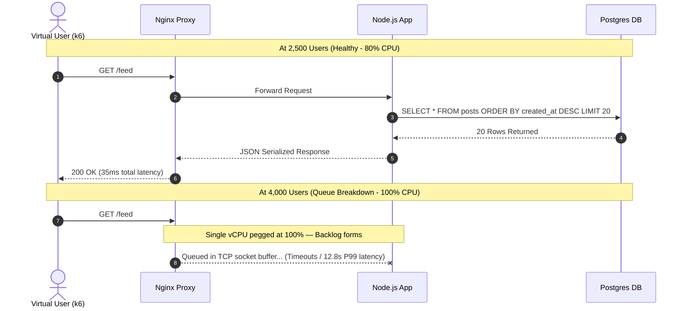

# 🚀 How Many Users Can a $12 Server Handle?

> **Source:** [YouTube: "How Many Users Can a $12 Server Handle?" (by Arjay McCandless)](https://www.youtube.com/watch?v=GFtFIxrAjIs)  
> **Tags:** `#system-design` `#performance` `#devops` `#benchmarking` `#caching` `#alvar-method` `#glossary`  
> **Date Added:** 2026-10-08  

---

## 📖 0. Technical Terms & Mental Models Glossary

Before diving into the experiment, here is a complete, beginner-to-advanced breakdown of every technical term used in this note.

### 🖥️ Hardware & Cloud Infrastructure
- **VPS (Virtual Private Server / "Droplet"):** A virtual machine hosted on a large physical data center server. A software layer called a *Hypervisor* carves the physical machine into isolated virtual slices with their own operating system.
- **Shared vCPU (Virtual CPU):** A virtual processing core. Unlike a *dedicated* CPU (where you own the physical silicon core 100% of the time), a *shared* vCPU shares time slices of a physical core with other virtual machines. If you max out 100% CPU for too long, the cloud provider may throttle your clock cycles.
- **RAM (Random Access Memory):** High-speed, volatile working memory where active programs, variables, and in-memory caches live. Data in RAM is accessed in nanoseconds (~10–100 ns), compared to milliseconds for disk.
- **NVMe SSD:** Solid State Drive connected via the high-speed PCIe bus. Reads/writes at ~3,000+ MB/s, vastly faster than old spinning HDDs or standard SATA SSDs.

---

### 👥 Traffic, Load & User Behavior
- **Virtual User (VU):** In load testing, a simulated bot that mimics a human user browsing your site (visiting pages, reading, clicking buttons).
- **RPS (Requests Per Second / Throughput):** The exact count of individual HTTP requests completed by the server every single second.
- **Think Time (User Pacing):** The realistic pause time between user actions (e.g., spending 3 to 5 seconds reading a tweet before clicking "like").
  $$\text{Throughput (RPS)} = \frac{\text{Number of Active Virtual Users}}{\text{Response Time} + \text{Think Time}}$$
- **Concurrent Users (Simultaneous Active Users):** Users actively browsing or holding an open session on your application during the exact same time window.
- **DAU (Daily Active Users) & MAU (Monthly Active Users):** Unique human users who open and use the application at least once in a 24-hour day or 30-day month. In production apps, **Peak Concurrent Users typically represent only 2% to 5% of DAU**.

---

### ⏱️ Latency & Performance Percentiles
- **Latency:** The total round-trip time it takes for a request to travel from the client, be processed by the server, and return the response.
- **Why "Average" Latency is a Trap:** If 99 users get a 10ms response, but 1 user experiences a 10,000ms (10-second) freeze, the *average* is ~110ms (looks deceptively fine!). But 1 out of 100 users had a broken experience.
- **P50 (Median Latency):** 50% of all requests were faster than this number. Represents the typical user experience.
- **P95 Latency:** 95% of requests were faster than this; only the worst 5% were slower.
- **P99 Latency (Tail Latency):** 99% of requests were faster than this; only the slowest 1% exceeded it. **P99 is the critical canary in the coal mine** because when queues back up under heavy load, P99 explodes first.

---

### ⚙️ Architecture, Caching & Backend Mechanisms
- **Reverse Proxy (Nginx):** A middleman server positioned between the public internet and your backend application. It handles SSL encryption/decryption (*SSL Termination*), compresses static assets (Gzip/Brotli), filters malicious traffic, and routes requests to the internal Node.js app.
- **Microcaching:** Caching dynamic API responses for ultra-short durations (e.g., **1 second**). If 1,000 users request the home feed within that 1 second, only the 1st request hits the backend database—the remaining 999 are served instantly from Nginx memory.
- **TTL (Time-To-Live):** The lifespan of a cached item before it expires and must be refreshed from the source.
- **Node.js Event Loop:** Node.js executes JavaScript on a **single main thread** using a non-blocking event loop. When CPU-heavy tasks occur (like JSON parsing/serialization or regex), the event loop gets blocked (*Event Loop Lag*), causing incoming network requests to stall.
- **JSON Serialization (`JSON.stringify` / `JSON.parse`):** Converting JavaScript memory objects into text strings to send over HTTP, and vice versa. This is computationally expensive on the CPU when dealing with thousands of requests per second.
- **Database Connection Pooling:** Maintaining a reusable pool of open database connections (e.g., 20 connections) rather than creating and destroying a heavy new TCP database process on every single HTTP request.
- **k6:** An open-source, developer-centric load testing tool written in Go that runs JavaScript-defined test scenarios to simulate thousands of concurrent virtual users.

---

## 1. Unconditional Truths (The Axioms)

1. **Virtual Users (VUs) $\neq$ Requests Per Second (RPS):** A concurrent user is not continuously hammering the server with 0ms delay. Humans read, scroll, and pause (*Think Time*). 1 VU making a request every 5 seconds generates only **0.2 RPS**.
2. **The Bottleneck Dictates Maximum Capacity:** A system can only scale as far as its tightest constraint (CPU compute, Memory capacity, Disk I/O, or Network Bandwidth). On modest single-box VPSs, **CPU saturation is almost always the first ceiling**, not RAM or Disk.
3. **Queueing Collapse is Non-Linear:** When server utilization passes ~80%, request queues balloon exponentially:
   $$W = \frac{\rho}{1-\rho}$$
   *(where $W$ is queue wait time and $\rho$ is CPU utilization)*. A system that feels snappy at 75% load will suffer cascading failure and timeout storms at 95% load.
4. **Tail Latency (P99) Reveals System Distress First:** When a server begins drowning, median latency (P50) might only climb from 20ms to 60ms, while P99 latency shoots from 100ms straight to 12,000ms.
5. **Microcaching Shifts the Bottleneck:** Caching dynamic API responses for even **1 single second** changes the request cost from *Database Query + JSON Serialization + HTTP Parsing* to *Pure RAM I/O*, increasing throughput by orders of magnitude.

---

## 2. Motivated Discovery (The Core Problem)

### Why this experiment matters
Junior developers and startup teams frequently jump straight to over-engineered architectures: **Kubernetes, microservices, distributed Redis clusters, and multi-region load balancers** before having significant traffic.

This experiment answers the grounded question:  
> **"What is the absolute limit of the simplest, cheapest production setup ($12/mo single VPS) running a realistic full-stack app?"**

### The Test Environment Specifications
- **Hardware:** DigitalOcean Droplet ($12/month)
  - **vCPU:** 1 Shared vCPU (Single Core)
  - **RAM:** 2 GB
  - **Storage:** NVMe SSD
- **Software Stack (Single Machine Monolith):**
  - **Reverse Proxy:** Nginx (handles SSL termination, request proxying, static files)
  - **Application Backend:** Node.js (Express / Fastify REST API)
  - **Database:** PostgreSQL (with indexed relations)
- **Simulated Domain:** Social Media Web Application
  - `GET /feed` (Fetch latest posts — ~70% traffic)
  - `GET /post/:id` (Fetch single post & comments — ~20% traffic)
  - `POST /post/:id/like` (Write operation — ~9% traffic)
  - `POST /post` (Heavy write operation — ~1% traffic)
- **Load Testing Engine:** **Grafana k6** running from an **independent external server** (ensuring load generation does not steal target CPU).

---

## 3. Dependency & Request Flow Map

```mermaid
graph TD
    User(["Virtual Users / Clients (k6)"])
    
    subgraph Single $12 VPS ["Single $12 VPS (1 vCPU, 2GB RAM)"]
        Nginx["Nginx Reverse Proxy (Written in C)"]
        NodeApp["Node.js API Server (V8 JavaScript Engine)"]
        Postgres[("PostgreSQL Database (Indexed Tables)")]
        
        Cache1[("Nginx Fast Microcache (RAM Buffer)")]
        Cache2[("Node.js In-Memory Cache (LRU Map)")]
    end
    
    User -->|HTTP Request| Nginx
    
    %% Stage 1 Flow
    Nginx -.->|Stage 1: Direct Forward| NodeApp
    NodeApp -.->|Stage 1: SQL Queries| Postgres
    
    %% Stage 2 Flow
    NodeApp -.->|Stage 2: Check RAM Cache (5s TTL)| Cache2
    
    %% Stage 3 Flow
    Nginx -.->|Stage 3: Fast Microcache (1s TTL)| Cache1
```

---

## 4. The 3 Benchmark Stages & Hard Numbers

| Stage | Optimization Strategy | Max Stable Concurrent Users | Requests/Sec (RPS) | Median Latency (P50) | Tail Latency (P99) | Primary Bottleneck |
| :--- | :--- | :--- | :--- | :--- | :--- | :--- |
| **Stage 1** | Baseline (No Caching, Direct DB) | **~2,500 Users** | ~280 RPS | 45 ms | ~180 ms | CPU Saturation (~80-99%) |
| **Stage 2** | Node.js In-Memory Cache (TTL: 5s) | **~4,000 Users** | ~1,200 RPS | 18 ms | ~1.1 s | Single-thread Node Event Loop |
| **Stage 3** | Nginx Reverse Proxy Microcache (1s) | **>10,000+ Users** | **>10,000 RPS** | <5 ms | <20 ms | Load Generator NIC / Client Limits |

---

### Detailed Stage Breakdown & Root-Cause Analysis

#### 🔹 Stage 1: The Raw Baseline (Postgres + Node.js + Nginx)
- **What happens:** Every incoming request hits Nginx, forwards to Node.js, and Node executes an indexed SQL query against Postgres on the same machine.
- **Results:**
  - Up to **2,000 Concurrent Users:** The server cruises effortlessly. Latency is low (<30ms).
  - At **2,500 Concurrent Users:** CPU hits ~80%. Throughput is around 250–280 RPS. The system is at optimal peak efficiency.
  - At **3,500 – 4,000 Concurrent Users:** **Catastrophic Failure.** CPU spikes to 99-100%. Node's event loop lag spikes. Request queues back up in Nginx. Median latency jumps to **2.7 seconds**, and P99 latency hits **12.8+ seconds**.
- **Crucial Discovery:** **RAM was never the issue.** RAM usage stayed below 600MB out of 2GB. The single vCPU spent all its time JSON serializing, parsing HTTP, and context switching between Node and Postgres.



---

#### 🔹 Stage 2: Application-Level In-Memory Cache (Node.js Memory)
- **The Optimization:** Store the result of `GET /feed` inside a simple JavaScript in-memory Map / LRU cache with a 5-second Time-To-Live (TTL).
- **The Impact:**
  - Postgres database query rate drops by over **95%**.
  - Capacity jumps from **2,500 to 4,000+ stable concurrent users**.
  - P99 latency drops from 12.8 seconds to ~1.0 second.
- **Why it still hit a wall at 4,500 users:** Even without database overhead, Node.js still had to accept the TCP connection, parse HTTP headers, JSON serialize the response object, and write to the socket for every request on a single CPU thread.

---

#### 🔹 Stage 3: Nginx Reverse-Proxy Microcaching (The Supercharger)
- **The Optimization:** Add a **1-second microcache** inside Nginx configuration:
  ```nginx
  # Reserve 10MB of shared memory for cache keys
  proxy_cache_path /tmp/nginx_cache levels=1:2 keys_zone=FEED_CACHE:10m inactive=60s;
  
  location /feed {
      proxy_cache FEED_CACHE;
      proxy_cache_valid 200 1s;           # Cache 200 OK responses for exactly 1 second
      proxy_cache_use_stale error timeout updating;
      proxy_pass http://localhost:3000;
  }
  ```
- **The Impact:**
  - For 1 whole second, only **1 single request** reaches Node.js and Postgres. All other thousands of requests are answered directly by Nginx out of memory in C-speed.
  - Throughput skyrocketed to **10,000+ Requests Per Second**.
  - Latency plunged to sub-5ms.
  - The $12 VPS wasn't breaking; the external load-testing machine ran out of network ports and CPU before the server broke!

---

## 5. Translating "Concurrent Users" to Real-World Business Metrics

Developers often confuse **Concurrent Active Users (Online Right Now)** with **Daily Active Users (DAU)**.

$$\text{Daily Active Users (DAU)} = \frac{\text{Peak Concurrent Users}}{\text{Peak Concurrency Ratio}}$$

In typical web applications, peak concurrent users represent roughly **2% to 5%** of total daily active users.

| Tested Concurrent Capacity | Equivalent Daily Active Users (DAU) | Monthly Active Users (MAU estimate) |
| :--- | :--- | :--- |
| **2,500 Concurrent Users** (Raw Base) | **~50,000 – 125,000 DAU** | **~500,000 – 1.5M MAU** |
| **4,000 Concurrent Users** (Node Cache) | **~80,000 – 200,000 DAU** | **~1M – 3M MAU** |
| **10,000+ Users** (Nginx Microcache) | **>250,000 – 500,000+ DAU** | **>5M+ MAU** |

> 💡 **Core Revelation:** A single $12 server with proper caching can support a startup from day 1 all the way up to **half a million daily users** before needing multi-server infrastructure.

---

## 6. Key Takeaways & Common Pitfalls

### ❌ Common Pitfalls & Myths Busted
1. **Myth: "Postgres will die first under load."**
   - *Reality:* Modern Postgres is extremely fast with proper indices and connection pooling. The Node.js application layer and CPU context-switching maxed out long before Postgres broke.
2. **Myth: "You need Redis immediately."**
   - *Reality:* For a single-node setup, an in-memory Map or Nginx microcache eliminates network overhead and gives 10x the throughput of an external Redis call over the network.
3. **Myth: "Microcaching causes stale data bugs."**
   - *Reality:* A 1-second cache TTL is completely invisible to human users reading a social feed, but it reduces database hits during spikes by up to 99.9%.

### 🎯 Best Practices for Peak Performance
- **Connection Pooling:** Use PgBouncer or a well-tuned connection pool (`max: 20-30`) so Postgres doesn't waste CPU spawning connection processes.
- **Offload Static & Read-Heavy traffic to the Edge / Proxy:** Let Nginx or a CDN (Cloudflare) handle static assets, compression (Gzip/Brotli), and read-heavy feeds.
- **Benchmarking Rule:** Always run load tests (k6/Locust) from an **isolated machine** in the same region, and model real user think times (`sleep(Math.random() * 3 + 1)`).

---

## 7. Actionable k6 Blueprint (Test It Yourself)

```javascript
// k6-load-test.js
import http from 'k6/http';
import { sleep, check } from 'k6';

export const options = {
  stages: [
    { duration: '1m', target: 500 },   // Step 1: Warm up with 500 virtual users
    { duration: '2m', target: 2500 },  // Step 2: Push to peak safe baseline (2,500 VUs)
    { duration: '1m', target: 4000 },  // Step 3: Stress test breaking threshold (4,000 VUs)
    { duration: '1m', target: 0 },     // Step 4: Graceful cooldown
  ],
  thresholds: {
    http_req_duration: ['p(95)<500', 'p(99)<1500'], // Latency SLAs (P95 < 500ms, P99 < 1500ms)
    http_req_failed: ['rate<0.01'],                 // Error rate must stay below 1%
  },
};

export default function () {
  const BASE_URL = 'http://YOUR_SERVER_IP';

  // 1. User loads feed (70% probability)
  const feedRes = http.get(`${BASE_URL}/api/feed`);
  check(feedRes, { 'feed status 200': (r) => r.status === 200 });

  // 2. Realistic Think Time (User reads for 2-4 seconds)
  sleep(Math.random() * 2 + 2);

  // 3. User views a post (20% probability)
  if (Math.random() < 0.2) {
    const postRes = http.get(`${BASE_URL}/api/post/42`);
    check(postRes, { 'post status 200': (r) => r.status === 200 });
    sleep(2);
  }
}
```
