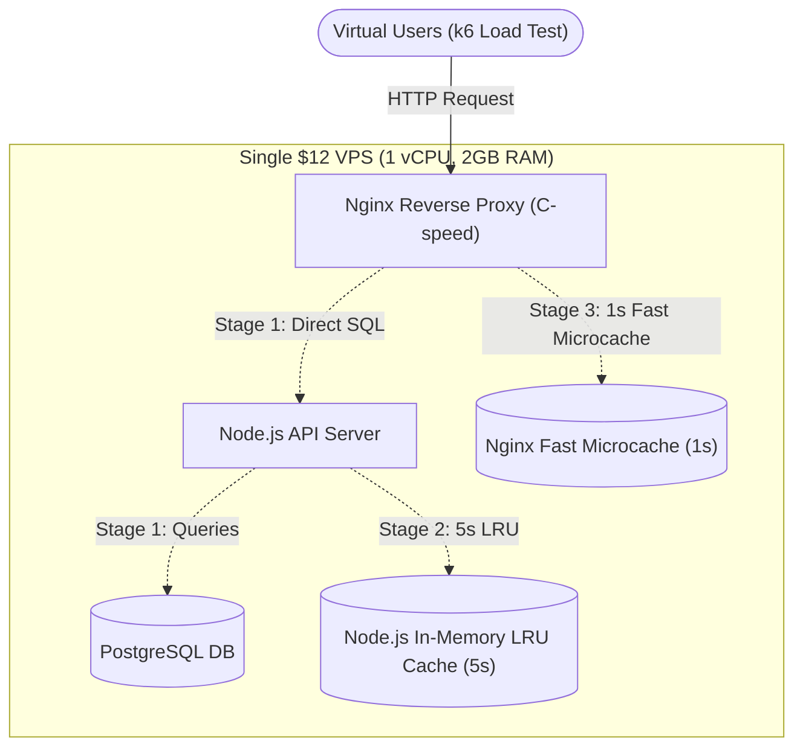

# 📺 COOL-YT: High-Signal Engineering Video Deconstructions

<div align="center">

[](https://obsidian.md)
[](README.md)
[](LICENSE)
[](https://github.com/karnVen/COOLYT)

**Distilling the highest-signal technical YouTube videos into structured, axiomatic engineering blueprints, benchmarks, and mental models.**

[Explore Creators](#-creators-catalog) • [Methodology](#-the-alvar-deconstruction-method) • [Latest Breakdown](#-highlight-video-01---how-many-users-can-a-12-server-handle) • [Obsidian Setup](#-obsidian-integration)

</div>

---

## 🌟 What is COOL-YT?

**COOL-YT** is a sub-system of the **AI-bou Central Knowledge Vault**. Rather than passively watching technical YouTube videos, we actively deconstruct them using the **Alvar Method (Probe → Plan → Teach → Lock-in)** to extract:

1. **Unconditional Truths & Axioms:** Core computational laws governing the domain.
2. **Motivated Discovery:** The real-world constraint or question that forced this engineering approach.
3. **Interactive Request & Failure Diagrams:** Mermaid visual maps of execution flows and queue bottlenecks.
4. **Empirical Benchmarks & Hard Numbers:** Quantitative stress tests (RPS, P95/P99 latencies, CPU/RAM limits).
5. **Technical Glossary & Mental Models:** Plain-English, beginner-to-advanced definitions for every term used.
6. **Actionable Blueprints:** Production configs (Nginx, Postgres) and reproducible test scripts (k6, Locust).

---

## 📂 Repository Hierarchy

```
COOLYT (08-Cool-YT)/
├── README.md                                  # Master Hub & Creator Index
│
└── Arjay-McCandless/                          # 👤 Creator: Arjay McCandless
    ├── README.md                              # Creator Video Catalog & Specialization
    └── 01-how-many-users-can-a-12-dollar-server-handle.md # Deep Benchmark & Scalability Guide
```

---

## 👤 Creators Catalog

| Creator / Channel | Focus Area | Videos Covered | Latest Insight |
| :--- | :--- | :---: | :--- |
| **[Arjay McCandless](Arjay-McCandless/README.md)** | Backend Systems, Benchmarking, Performance | `1` | Single $12 VPS handles **2,500 concurrent users** raw, **>10,000 RPS** with 1s Nginx microcache |

---

## ⚡ Highlight: Video 01 — "How Many Users Can a $12 Server Handle?"

> 🔗 **Source:** [YouTube: "How Many Users Can a $12 Server Handle?" (by Arjay McCandless)](https://www.youtube.com/watch?v=GFtFIxrAjIs)  
> 📄 **Complete Note:** [`Arjay-McCandless/01-how-many-users-can-a-12-dollar-server-handle.md`](Arjay-McCandless/01-how-many-users-can-a-12-dollar-server-handle.md)

### 📊 Benchmark Summary Table

| Benchmark Stage | Strategy | Max Stable Concurrent Users | Throughput (RPS) | Median Latency (P50) | Tail Latency (P99) | The Real Bottleneck |
| :--- | :--- | :---: | :---: | :---: | :---: | :--- |
| **Stage 1 (Baseline)** | Direct Postgres query per request | **~2,500 VUs** | ~280 RPS | 45 ms | ~180 ms | **CPU Saturation** (80-99%) |
| **Stage 2 (App Cache)** | Node.js Memory Cache (5s TTL) | **~4,000 VUs** | ~1,200 RPS | 18 ms | ~1.1 s | Single-thread Node Event Loop |
| **Stage 3 (Microcache)**| Nginx Reverse Proxy Cache (1s TTL) | **>10,000+ VUs** | **>10,000 RPS** | <5 ms | <20 ms | Client Load Generator Limits |

### 🔍 Request & Saturation Flow



### 💡 The Big Takeaways
1. **Virtual Users $\neq$ Requests Per Second:** Human think time (2–4s) means 2,500 concurrent users generate only **~280 RPS**.
2. **RAM was NEVER the bottleneck:** RAM stayed below 600MB/2GB. Single vCPU JSON serialization was the breaking point.
3. **The Power of 1s Microcaching:** Caching for just 1 second turns compute-heavy database hits into pure RAM I/O, scaling capacity to **>10,000 RPS**.
4. **Real-World DAU Conversion:** 2,500 concurrent users $\approx$ **50,000 to 125,000 Daily Active Users** (DAU) before needing multi-server infrastructure.

---

## 🧭 The Alvar Deconstruction Method

Every document in this vault is structured using the Alvar format:
1. **`0. Technical Terms Glossary`** — Zero jargon left unexplained; every concept has an intuitive mental model.
2. **`1. Unconditional Truths`** — Axioms that remain true regardless of framework or cloud vendor.
3. **`2. Motivated Discovery`** — The engineering problem that necessitated this solution.
4. **`3. Architecture & Dependency Map`** — Mermaid diagrams illustrating pipelines and failure cascades.
5. **`4. Benchmark Stages & Numbers`** — Real metrics, latency percentiles, and root cause analysis.
6. **`5. Business & Scale Translation`** — Converting concurrent test numbers into DAU/MAU.
7. **`6. Key Takeaways & Pitfalls`** — Common myths debunked.
8. **`7. Actionable Blueprints`** — Copy-paste configs and test harnesses.

---

## 🔮 Obsidian Integration

This vault is 100% Obsidian-native:
- Native Markdown formatting with GitHub alerts (`> [!NOTE]`, `> [!TIP]`)
- Mermaid diagram rendering
- LaTeX math formulas ($$W = \frac{\rho}{1-\rho}$$)
- Internal wiki-links (`[[Arjay-McCandless/01-how-many-users-can-a-12-dollar-server-handle]]`)

---

<div align="center">

Crafted with ❤️ as part of the **AI-bou Learning System**.

</div>
